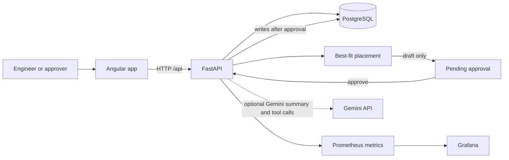

# OpsPilot

OpsPilot is a capacity management demo for data-center sites, racks, and servers. Engineers submit server capacity requests. A placement service (optionally assisted by Gemini) drafts a recommendation. **An approver must approve it before the API creates servers or changes rack occupancy.** Proposals, inventory writes, and review decisions are recorded in the audit log.

## Run on a Mac

1. Open Docker Desktop and wait until it is running.
2. Open Terminal and go to this project folder:

   ```sh
   cd ~/Documents/Codex/2026-11-17/i-x20
   ```

3. Start all services:

   ```sh
   docker compose up --build
   ```

4. Open [http://localhost:4200](http://localhost:4200).

Keep Terminal open while using the app. Press **Control+C** there to stop it. Use `docker compose up --build -d` to start in the background and `docker compose down` to stop background services.

## Publish a portfolio demo

The included `render.yaml` deploys the web app and PostgreSQL database to Render. The free plan is suitable for a temporary portfolio demo: free web services can sleep when idle, and free PostgreSQL databases expire after 30 days. For an always-available demo with retained data, choose paid plans in Render before creating the Blueprint; check Render's current pricing first.

1. Create a GitHub repository and upload this project folder. Do not upload `.env` files or passwords you use anywhere else.
2. Create a Render account and connect it to GitHub.
3. In Render, choose **New → Blueprint**, select the OpsPilot repository, and create the services from `render.yaml`.
4. Wait for the web service to finish deploying, then open its `onrender.com` address. Share that address in your portfolio or LinkedIn.

This is a shared demo with public demo credentials. Use sample data only; do not put real company or personal data in it. The optional Gemini key can be left blank.

## Local demo accounts

- **Approver:** `approver@opspilot-demo.com` / `LocalDev123!`
- **Engineer:** `engineer@opspilot-demo.com` / `Engineer123!`
- Self-registered accounts receive viewer access.
- **Grafana:** `admin` / `opspilot-local`

The demo accounts and secrets in Compose are for local development only. Replace them before sharing or deploying the project.

## Try the approval flow

1. Sign in as the engineer or approver.
2. Open **Inventory** and add a site, then add one or more racks with server slots.
3. Open **Requests** and request servers at that site.
4. Choose **Suggest placement**. The proposal stays pending and rack usage does not change.
5. Sign in as an approver and open **Approvals**.
6. Approve or reject. Only approval creates server rows and increments occupied slots.

## Services

| Service | Address | Purpose |
|---|---|---|
| Angular web app | [localhost:4200](http://localhost:4200) | Inventory, request, and approval screens |
| FastAPI | [localhost:8000/docs](http://localhost:8000/docs) | API and interactive OpenAPI docs |
| Health | [localhost:8000/health](http://localhost:8000/health) | API health check |
| Prometheus | [localhost:9090](http://localhost:9090) | Scraped application metrics |
| Grafana | [localhost:3000](http://localhost:3000) | OpsPilot operations dashboard |

## Architecture



The server computes the actual placement using the greedy algorithm. Gemini can read through restricted tools and draft an explanation when `OPSPILOT_GEMINI_API_KEY` is set. Server-side validation checks any proposal against the deterministic placement, and the agent tools cannot approve or execute changes. Without an API key, the safe deterministic summary is used.

## Development and tests

Backend requires Python 3.11 or newer. Frontend uses Angular and Node 22.

```sh
cd backend
pip install -e '.[dev]'
python -m pytest --cov=app --cov-report=term-missing
```

Placement unit tests run without a database. API integration tests require a dedicated test database because the fixture drops and recreates its schema. Set `TEST_DATABASE_URL` to an isolated PostgreSQL database before running those tests. GitHub Actions creates a separate PostgreSQL service for them. Do not point `TEST_DATABASE_URL` at a database with data you need.

Offline placement evaluation:

```sh
python eval/run_eval.py
```

Latest local results: **5/5 placement unit tests passed**; **30/30 offline evaluation scenarios passed (100%)**. The evaluation covers placement feasibility, output shape, and the human-approval boundary, including five prompt-injection examples. It exercises the deterministic fallback; it is not a measured live Gemini model evaluation. API integration tests, frontend build/tests, Lighthouse, axe, and a demo recording are configured or documented but still need to be run and recorded in an environment with the required services.

## Gemini setup (optional)

Create a Gemini API key, then export it in the same Terminal before `docker compose up --build`:

```sh
export OPSPILOT_GEMINI_API_KEY="your-key"
docker compose up --build
```

The app uses Gemini function calling only for read tools and a draft-only proposal tool. The approval endpoint remains a separate human action. If Gemini times out or returns invalid output, the service logs the failure and falls back to a validated deterministic summary.

## Production setup

The Compose credentials, database password, Grafana password, and JWT signing key are local demo values. Use managed secrets, HTTPS, a restricted database account, and a production-grade token revocation strategy before deployment. Refresh tokens are signed and time-limited but are not stored server-side for revocation in this portfolio build.
